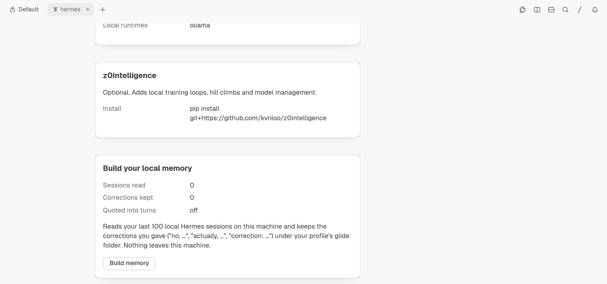
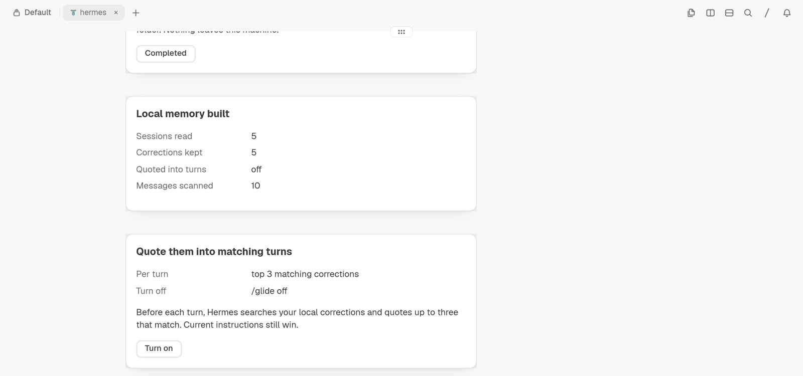
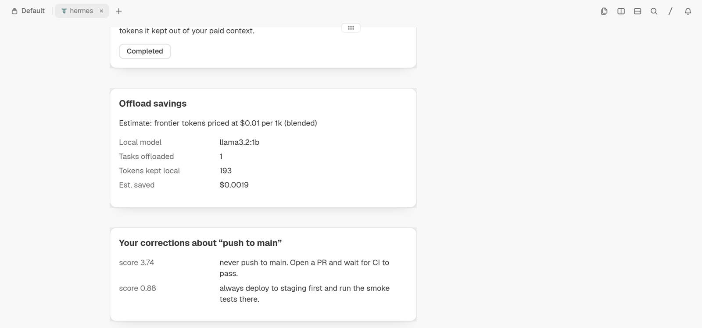
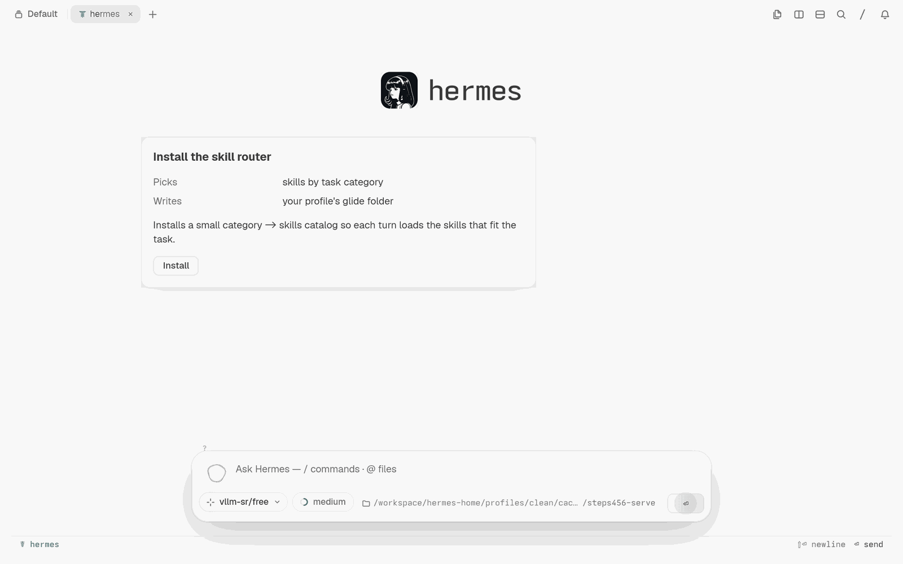
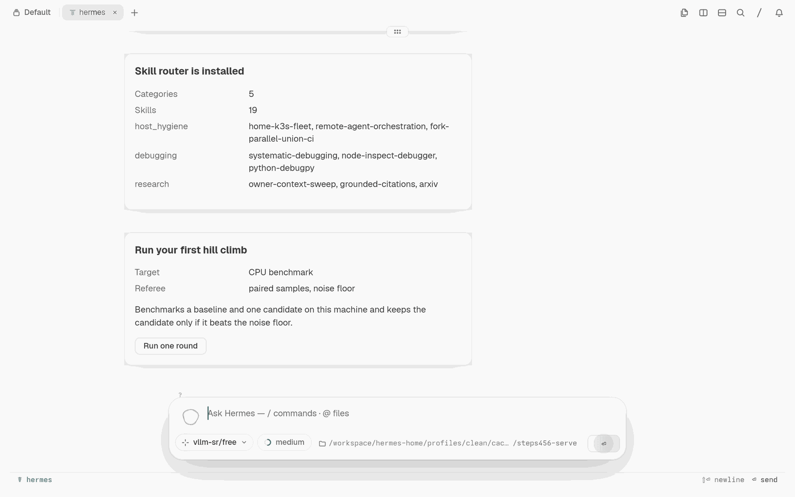
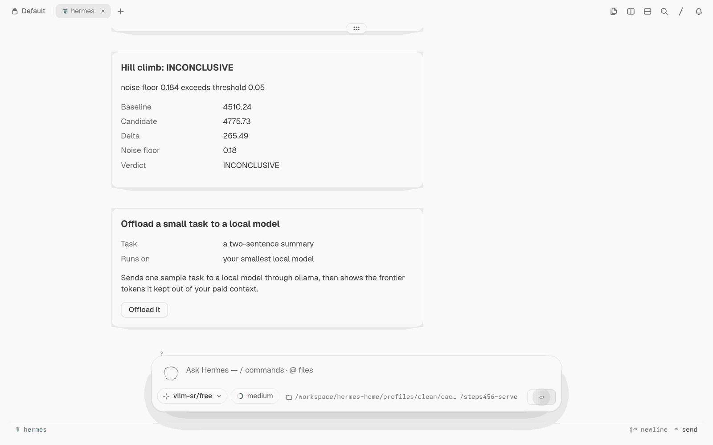
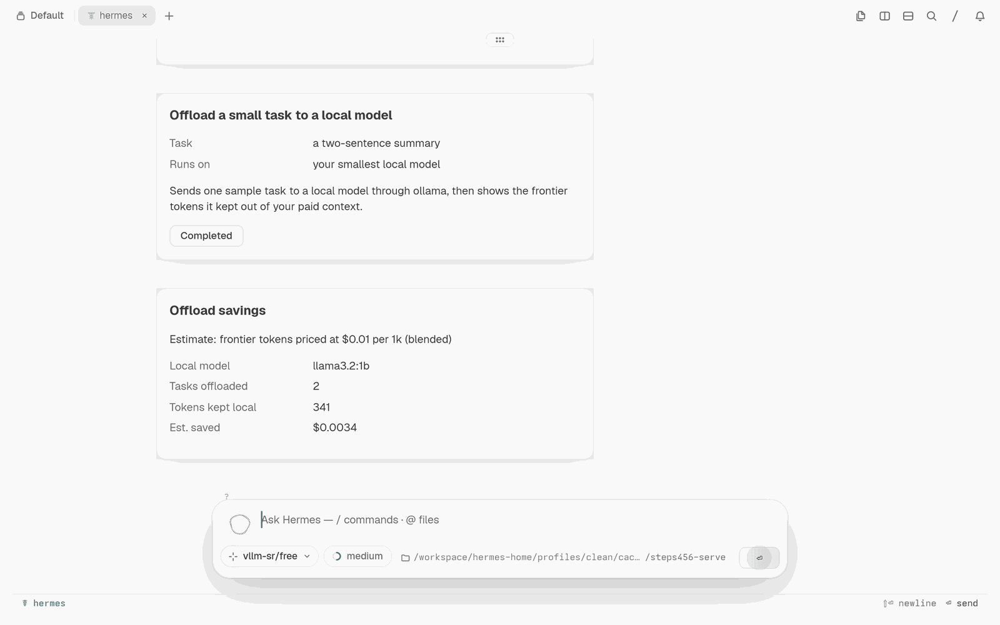
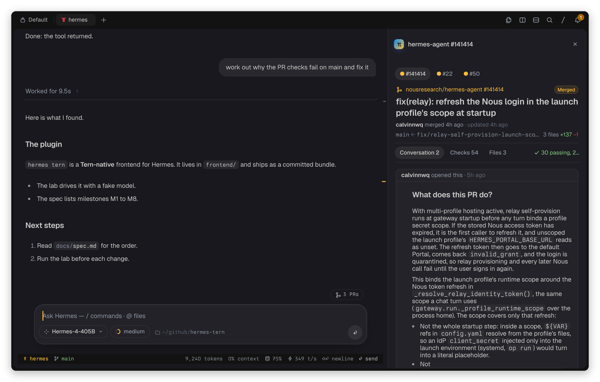

# Glide

An agent workspace that guards two scarce resources: your attention and the agent's context window. Glide is a [Hermes Agent](https://github.com/NousResearch/hermes-agent) plugin with a native [Tern](https://stencil.so/tern) chat frontend.

- **Your attention.** `/glide focus` shows your phase, next deep-work window, and bedtime. A deep-work block holds non-critical agent asks and hands them back as one digest. At wind-down it saves where you left off, and the next morning's first turn starts there. It learns your best hours from your own local sessions and uses z0intelligence's circadian schedule and a Flowkit flow likelihood when they are installed. [Attention](glide/docs/attention.md)
- **The agent's context.** Opt-in corrections memory quotes up to three matching past corrections into a turn, so you stop repeating yourself; offload sends small tasks to a local model. [Memory implementation](glide/docs/memory.md)

Derived from alt-glitch/hermes-tern (MIT). This fork adds the Glide memory backend, attention guard, onboarding cards, a skill-ranking catalog, a benchmark referee, local-model offload, local fleet and intelligence cards, and the Dash-derived design language. [Submission](docs/SUBMISSION.md) · [Fork details](FORK.md) · [License](LICENSE)

## Install

Use a current Hermes Agent with standalone-plugin and gateway support, Tern, and Node.js. The plugin manifest requires Hermes ≥0.23.0. [Manifest](plugin.yaml) · [Launcher](launcher.py)

Hermes scans community plugins before installing them. It rates this one **CAUTION**, the same verdict it gives [alt-glitch/hermes-tern](https://github.com/alt-glitch/hermes-tern) itself. The HIGH findings are text matches in the Tern frontend: the sudo-password prompt UI and the Markdown code-span parser. Review them, then answer `y` at the prompt (or pass `--force` in a non-interactive shell). This guide does not bypass the check. [Hermes installer](https://github.com/NousResearch/hermes-agent/blob/b3746e35ddd32079697728e2df57a9d78f1e9e32/hermes_cli/plugins_cmd_install.py)

```sh
hermes plugins install kvnloo/glide
```

After a successful install, accept Hermes' plugin-enable prompt. One install includes the Tern frontend and Glide. The installed plugin is named `glide` (earlier releases used `hermes-tern`; its data folders move to the new name on first load, and settings under `plugins.entries.hermes-tern` must be set again under `plugins.entries.glide`). Do not also install the standalone `glide/` subdirectory into the same profile. [Registration](https://github.com/kvnloo/glide/pull/223)

In a Tern pane, outside tmux, screen, or zellij:

```sh
hermes tern
```

The frontend needs Tern's Surface Protocol. An ordinary terminal cannot render it. [Launcher contract](launcher.py)

## Guard your attention

In the attached Tern chat:

```text
/glide focus
```

1. **Focus card.** Phase, flow likelihood (only with a live Flowkit estimate; an estimate, not a diagnosis), next deep-work window, bedtime, and how many asks are held.
2. **Start block.** Approve a 50-minute block. Hermes keeps replies short and holds non-critical questions. Notices routed through `glide.route` wait; `critical` still passes.
3. **End block.** One digest card lists everything held.
4. **Wind-down.** `/glide focus wind-down` saves your last session's open asks; tomorrow's first turn quotes them once.
5. **Your hours.** `/glide focus hours` shows the two-hour windows you worked in most over the last 30 days.

With no wearable and no z0intelligence, everything comes from your local session timestamps. [How it decides](glide/docs/attention.md)

## Guard the context window

In the attached Tern chat, enter:

```text
/glide
```

The [card flow](frontend/src/commands/glide.ts) presents these steps. Each write or benchmark waits for its approval button.

1. **Detect.** Inspect CPU, RAM, GPU, local runtimes, and optional z0intelligence health. Detection installs nothing.
2. **Build memory.** Approve a read of up to 100 recent eligible local sessions, excluding the current session. Glide keeps user messages that begin with `Correction:`, `Actually,`, or `No,`. Review the counts on the proof card. A new profile needs prior corrections before recall can return a match.
3. **Turn on.** Approve the recall hook. Current instructions take precedence over quoted history.
4. **Skill router.** Approve **Install** to save the built-in category-to-skills catalog. This installs ranking metadata, not the referenced skills or an automatic per-turn skill loader.
5. **Hill climb.** Approve **Run one round** to repeat the same CPU benchmark command for baseline and candidate samples to demonstrate noise handling. The referee can report KEEP, REVERT, or INCONCLUSIVE. This demo does not edit code or train a model.
6. **Offload.** With Ollama and an existing local model available, approve **Offload it** to send one sample summary task to that model. The savings card reports estimated tokens and cost, not a measured billing reduction. No model is downloaded for you.

For a correction about frontend work, inspect the matching history:

```text
/glide recall frontend
```

Disable automatic quoting:

```text
/glide off
```

Memory extraction and BM25 ranking make no model calls. If an existing z0intelligence corrections reader returns matches, recall prefers those and otherwise falls back to Glide's store. [Recall selection](glide/core.py) Glide opens the source database read-only and writes derived memory under the active profile's `glide/` directory. Once you enable recall, excerpts enter Hermes' model context and can reach your configured remote provider. Do not enable it for history you do not want that provider to receive. [Storage and privacy contract](glide/docs/memory.md)

## More in the chat

These commands show local state as native cards in the chat.

| Command | What it shows |
|---|---|
| `/theme` | Pick the colours: Tern, Nous, the Hermes skin, the wallpaper (pywal, live) or Dash's black and gold. `/glide theme auto\|dash` sets the same. |
| `/glide glass` | A liquid-glass demo card. It is the only surface allowed to glow. |
| `/glide taste` | The newest Taste Atlas board beside the chat. [Requirements](glide/docs/taste.md) |
| `/glide studio [project-id]` | Opens fframestudio and previews the selected project's scene layers. [Requirements](glide/docs/studio.md) |
| `/glide lanes` | Live-voice helper lanes, their model and billing. |
| `/intel` | Local intelligence: hill climbs, skills, memory, failures, traces. |
| `/hosts` | Fleet hosts, agents, gauges and k3s pods. |
| `/portfolio` | Work portfolios, products and tasks. |
| `/factory` | The content factory graph, runs and renders. [Factory](glide/docs/factory.md) |
| `/council` | A Socratic council popup with one verdict per seat. |

Every card follows one design language: omp's card grammar and Dash's palette, text at 11 px or larger, no glow outside `/glide glass`. A token drift test fails on any radius, size or colour that is not a token. [Design language](docs/DESIGN-LANGUAGE.md)

## Real Tern screenshots

Captured from a fresh `HERMES_HOME` after `hermes plugins install kvnloo/glide`, with six synthetic sessions seeded by [demo/seed.py](glide/demo/seed.py). No personal history appears.









The inherited base chat is shown below, not a Glide onboarding capture.



## Check a fresh install yourself

`bash scripts/e2e-fresh-install.sh` installs `kvnloo/glide` from GitHub into a throwaway `HERMES_HOME`, validates it, and runs every `/glide` command against synthetic sessions through Hermes' real plugin loader. It never touches your real profile. [Details](glide/docs/fresh-install.md)

## What runs beyond a prompt

- [Python memory backend](glide/memory.py), [source reader](glide/source.py), and [atomic storage](glide/storage.py) resolve eligible message generations and build a bounded local BM25 index.
- The [registered hook and command](glide/core.py) add matching corrections before model calls. [Session-bound gateway methods](glide/gateway.py) validate parameters and serve the cards on a Hermes core with `ctx.register_gateway_method`. Released Hermes does not have it, so those methods are skipped and the cards run through the `/glide` command.
- The [TypeScript flow](frontend/src/commands/glide.ts) renders native cards and handles approval actions. [Router](glide/skill_router.py), [benchmark](glide/hill_climb.py), and [Ollama offload](glide/offload.py) modules persist their own results.
- Opt-in live voice (`/live` or Alt+Shift+V) shows helper lanes beside the thinking orb. They read real state from a local lane broker on `127.0.0.1:8791` and stay off without its token file. Live voice needs a Hermes gateway with the `voice.live` methods; the pinned Hermes may lack them, which shows a visible activation failure. [Voice and lanes](frontend/docs/voice.md)

Optional z0intelligence health detection does not install or configure z0intelligence. The optional Taste pane needs a separately running Taste Atlas app and is not part of the basic memory flow. [Core](glide/core.py) · [Taste requirements](glide/docs/taste.md)

See [the upstream project](https://github.com/alt-glitch/hermes-tern) for the base frontend and [frontend development](frontend/README.md) for build instructions.

## Credits and license

Derived from alt-glitch/hermes-tern (MIT), by [alt-glitch](https://github.com/alt-glitch/hermes-tern). Glide additions are by Kevin Rajan. The frontend began as [can1357's ui-tsp](https://github.com/can1357/hermes-agent/tree/tern-frontend), and some UI patterns come from [T3 Code](https://github.com/pingdotgg/t3code).

MIT. See [LICENSE](LICENSE) and the [Glide license](glide/LICENSE).
