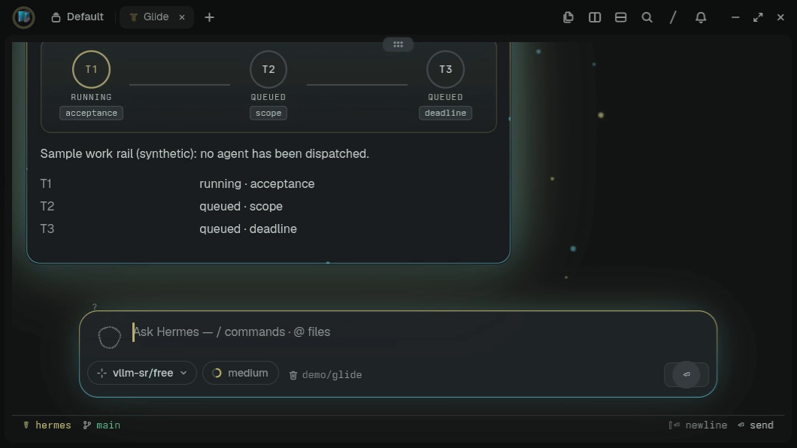
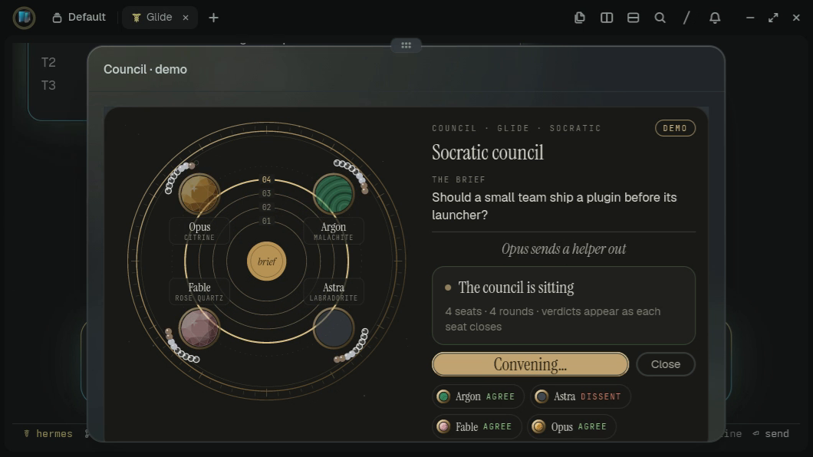
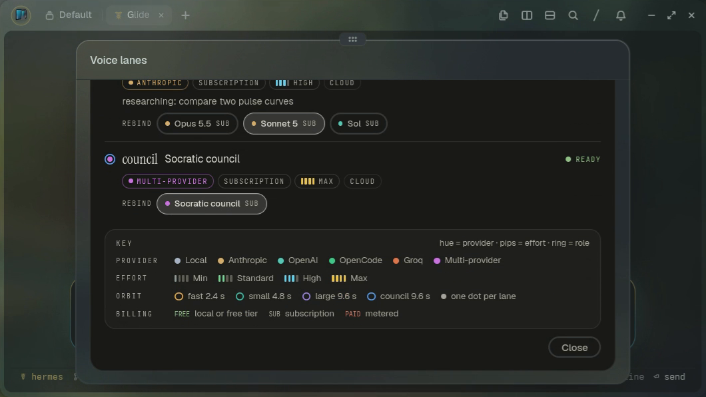
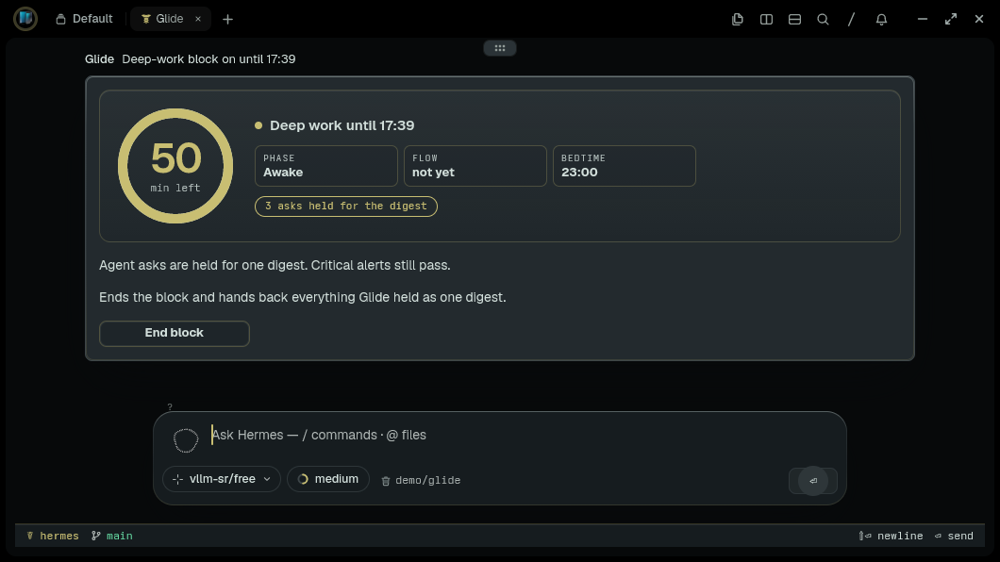
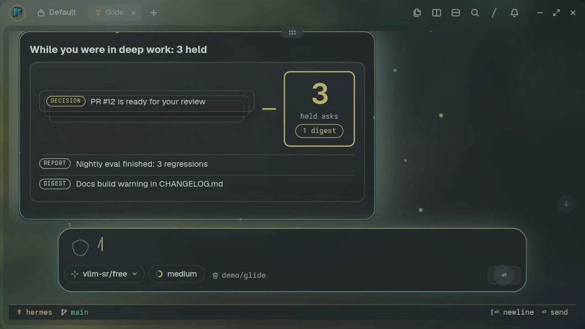
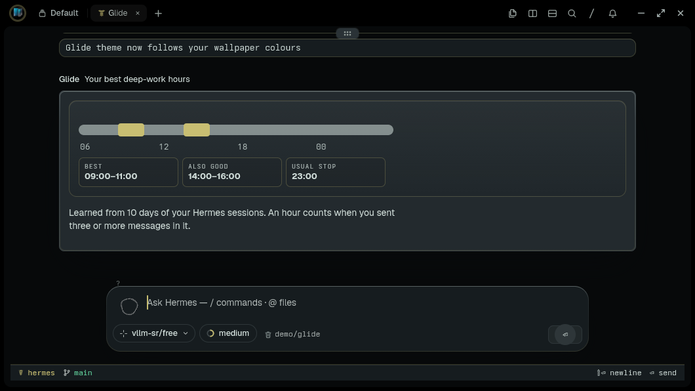
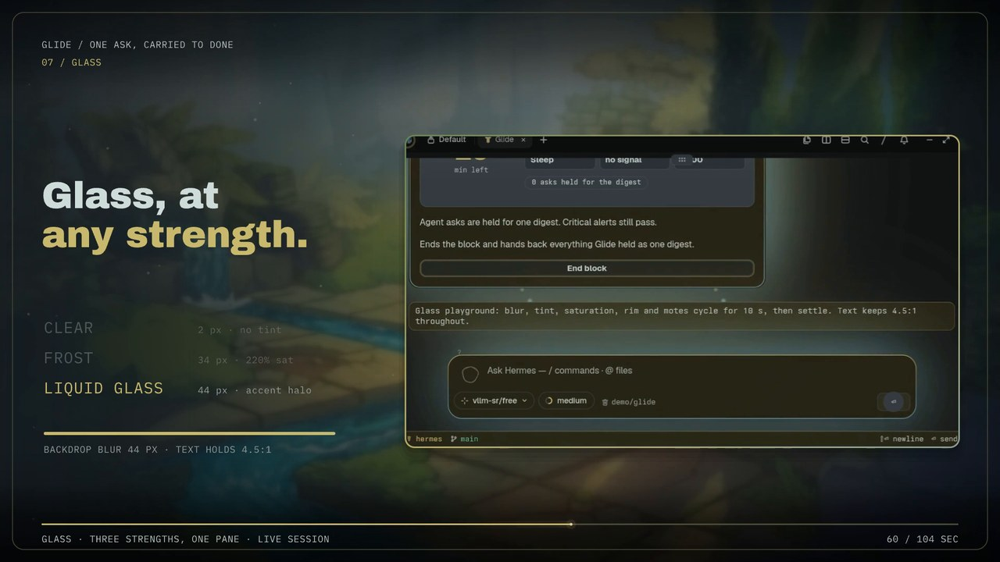
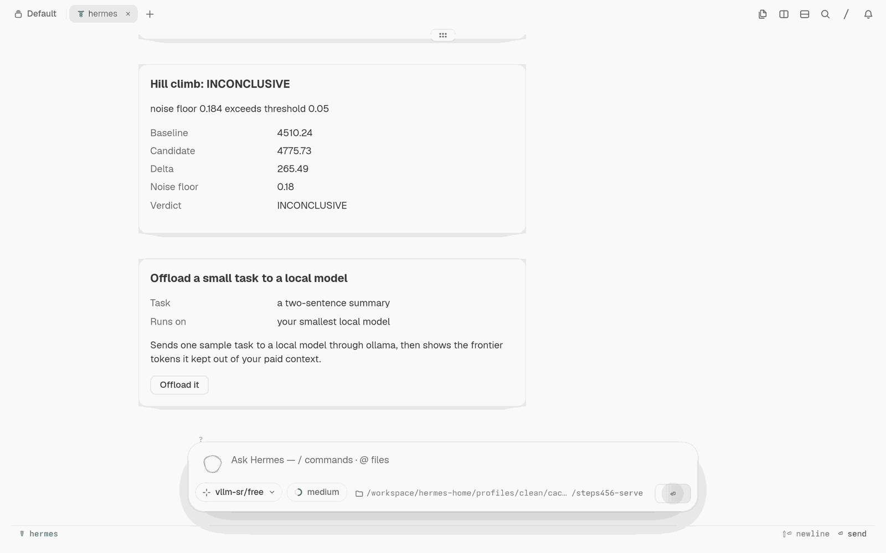

# Glide

A [Hermes Agent](https://github.com/NousResearch/hermes-agent) plugin with a native [Tern](https://stencil.so/tern) chat frontend. Glide turns one ask into cards you can inspect and approve, and it guards two scarce resources along the way: your attention and the agent's context window.

[](https://github.com/kvnloo/glide/releases/tag/film-v41)

**[Watch the film](https://github.com/kvnloo/glide/releases/tag/film-v41)** · 1080p60, 1:44 · [download mp4](https://github.com/kvnloo/glide/releases/download/film-v41/glide-film.mp4). Every Tern shot in it is a live take over sample data.

## Install

You need Hermes Agent ≥0.23.0 with standalone-plugin support, Tern, and Node.js.

```sh
hermes plugins install kvnloo/glide
hermes tern        # in a Tern pane, outside tmux/screen/zellij
```

Accept Hermes' enable prompt. One install ships the Tern frontend and Glide as a plugin named `glide`. Earlier releases used `hermes-tern`: data folders move to the new name on first load, but settings under `plugins.entries.hermes-tern` must be set again under `plugins.entries.glide`. Don't also install the `glide/` subdirectory into the same profile. The frontend needs Tern's Surface Protocol, so an ordinary terminal can't render it. [Registration](https://github.com/kvnloo/glide/pull/223) · [Launcher](launcher.py)

Hermes' plugin scanner rates Glide **CAUTION**, the same verdict it gives [alt-glitch/hermes-tern](https://github.com/alt-glitch/hermes-tern). Its HIGH findings are text matches in the frontend's sudo-password prompt and Markdown code-span parser. Review them, then answer `y` (or pass `--force` non-interactively).

## Features

| | |
|---|---|
| **Declare an intent.** `/glide intent <ask>` turns an ask into declaration, contract and approval cards, then a work rail. The rail is a labelled sample: no agent is dispatched. |  |
| **Convene a council.** `/council` opens a Socratic review where model seats vote on a hard call. Without `GLIDE_COUNCIL_URL` the run is a labelled **DEMO**. |  |
| **Watch the lanes.** `/glide lanes` shows each live model lane's state and words as it works. Without a lane broker it says **NOT CONNECTED** instead of drawing one. |  |
| **Hold a deep-work block.** `/glide focus` shows your phase, bedtime and next deep-work window. Start a 50-minute block and non-critical agent asks wait; critical ones still pass. |  |
| **Get one digest.** `/glide focus stop` ends the block and hands back every held ask once. |  |
| **Know your hours.** `/glide focus hours` draws the two-hour windows you worked in most over 30 days, learned from your own local sessions. |  |
| **Wind down.** `/glide focus wind-down` saves where you left off; tomorrow's first turn starts there. |  |
| **Wear the wallpaper.** `/glide theme auto` themes Tern from your pywal colors (or `GLIDE_WAL_COLORS`) with liquid-glass cards; `default` reverts, `export` writes the palette. |  |

Also: `/hosts`, `/portfolio` and `/factory graph` render validated fleet and factory cards from local sources (missing sources never become fictional hosts), and `/glide taste` opens a separately running [Taste Atlas](glide/docs/taste.md) board in a pane. Live voice (`/live`, Alt+Shift+V) needs a Hermes gateway with `voice.live` methods and a local lane broker. [Voice and lanes](frontend/docs/voice.md)

Attention features need no wearable: they learn from your local session timestamps, and use z0intelligence's circadian schedule and a Flowkit flow estimate when installed. [Attention contract](glide/docs/attention.md)

Screenshots are live Tern takes over synthetic data; the glass still is from the film.

## Corrections memory

`/glide` walks an opt-in onboarding flow. Each write or benchmark waits for its approval button.

1. **Detect** CPU, RAM, GPU, local runtimes and optional z0intelligence health. Installs nothing.
2. **Build memory** from up to 100 recent local sessions (not the current one), keeping user messages that start with `Correction:`, `Actually,` or `No,`.
3. **Turn on** recall: up to three matching past corrections are quoted into a turn, so you stop repeating yourself. Current instructions win over quoted history.
4. **Skill router** saves a category-to-skills ranking catalog (metadata only, no skills installed).
5. **Hill climb** runs one CPU benchmark round; the referee reports KEEP, REVERT or INCONCLUSIVE. It edits no code.
6. **Offload** sends one sample task to an existing Ollama model and estimates the tokens saved (an estimate, not a billing measurement).

`/glide recall <words>` shows matching corrections; `/glide off` stops quoting.

| Detect | Memory built | Recall hit |
|---|---|---|
|  |  |  |
| **Skill router** | **Hill climb** | **Offload** |
|  |  |  |

Captured from a fresh `HERMES_HOME` with six synthetic sessions from [demo/seed.py](glide/demo/seed.py).

**Privacy.** Extraction and BM25 ranking make no model calls. Glide opens the session database read-only and writes derived memory under the profile's `glide/` directory. Once recall is on, quoted excerpts enter the model context and can reach your configured provider, so don't enable it for history you don't want that provider to see. [Storage and privacy contract](glide/docs/memory.md)

## Verify a fresh install

```sh
bash scripts/e2e-fresh-install.sh
```

Installs `kvnloo/glide` from GitHub into a throwaway `HERMES_HOME` and runs every `/glide` command against synthetic sessions through Hermes' real plugin loader. Your profile is never touched. [Details](glide/docs/fresh-install.md)

## Code map

- Memory: [backend](glide/memory.py), [source reader](glide/source.py), [atomic storage](glide/storage.py), [hook and command](glide/core.py). The [gateway methods](glide/gateway.py) need `ctx.register_gateway_method`, which released Hermes lacks, so cards run through the `/glide` command for now.
- Cards: [`/glide` flow](frontend/src/commands/glide.ts), [intent](glide/frontend/intentCards.ts), [council](glide/frontend/councilPopup.ts), [lanes](glide/frontend/lanesPopup.ts), [fleet](frontend/src/commands/fleet.ts) + [adapter](glide/fleet.py), [theme](glide/frontend/wal.ts) + [glass](glide/frontend/glass.ts).
- [Attention](glide/attention.py), [skill router](glide/skill_router.py), [benchmark](glide/hill_climb.py), [offload](glide/offload.py). Frontend build: [frontend/README.md](frontend/README.md).

## Credits and license

Derived from [alt-glitch/hermes-tern](https://github.com/alt-glitch/hermes-tern) (MIT). The frontend began as [can1357's ui-tsp](https://github.com/can1357/hermes-agent/tree/tern-frontend); some UI patterns come from [T3 Code](https://github.com/pingdotgg/t3code). Glide additions by Kevin Rajan. [Fork details](FORK.md) · [Submission](docs/SUBMISSION.md)

MIT. See [LICENSE](LICENSE) and the [Glide license](glide/LICENSE). Film music: "Aerosol of my Love", Kevin MacLeod, CC BY 4.0.
