# Glide

An agent workspace that guards two scarce resources: your attention and the agent's context window. Glide is a [Hermes Agent](https://github.com/NousResearch/hermes-agent) plugin with a native [Tern](https://stencil.so/tern) chat frontend.

- **Your attention.** `/glide focus` shows your phase, next deep-work window, and bedtime. A deep-work block holds non-critical agent asks and hands them back as one digest. At wind-down it saves where you left off, and the next morning's first turn starts there. It learns your best hours from your own local sessions and uses z0intelligence's circadian schedule and a Flowkit flow likelihood when they are installed. [Attention](glide/docs/attention.md)
- **The agent's context.** Opt-in corrections memory quotes up to three matching past corrections into a turn, so you stop repeating yourself; offload sends small tasks to a local model. [Memory implementation](glide/docs/memory.md)

Derived from alt-glitch/hermes-tern (MIT). This fork adds the Glide memory backend, attention guard, onboarding cards, a skill-ranking catalog, a benchmark referee, local-model offload, local fleet and intelligence cards, and the Dash-derived design language. [Submission](docs/SUBMISSION.md) · [Fork details](FORK.md) · [License](LICENSE)

[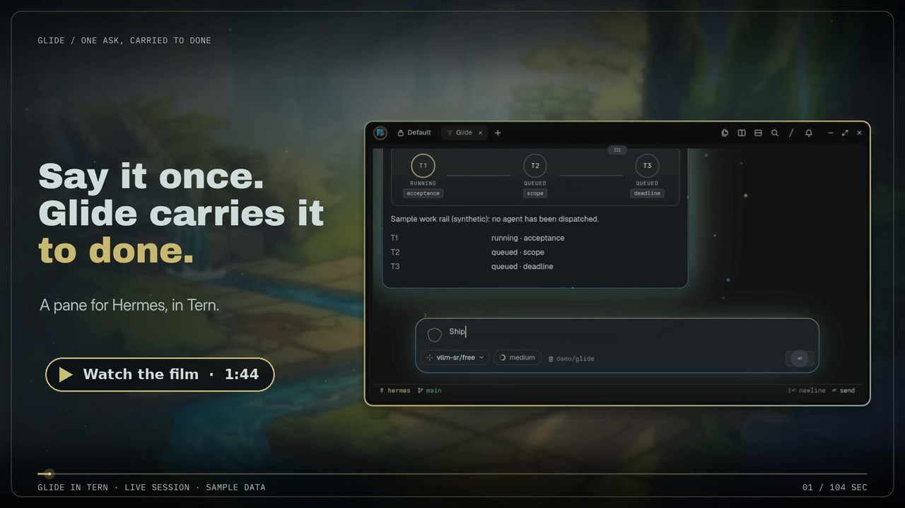](https://github.com/kvnloo/glide/releases/tag/film-v41)

**[Watch the film](https://github.com/kvnloo/glide/releases/tag/film-v41)** · 1080p60, 1:44 · [download mp4](https://github.com/kvnloo/glide/releases/download/film-v41/glide-film.mp4). Every Tern shot in it is a live take over sample data.

## Install

You need [Hermes Agent](https://github.com/NousResearch/hermes-agent) ≥0.23.0, [Tern](https://stencil.so/tern) and Node.js. [Manifest](plugin.yaml)

```sh
hermes plugins install kvnloo/glide
hermes tern        # in a Tern pane, outside tmux, screen or zellij
```

Accept Hermes' enable prompt. One install ships the Tern frontend and Glide as one plugin named `glide`. Earlier releases used `hermes-tern`: their data folders move to the new name on first load, but settings under `plugins.entries.hermes-tern` must be set again under `plugins.entries.glide`. Don't also install the `glide/` subdirectory into the same profile. The frontend needs Tern's Surface Protocol, so an ordinary terminal can't render it. [Registration](https://github.com/kvnloo/glide/pull/223) · [Launcher](launcher.py)

Hermes' plugin scanner may rate the install **CAUTION**, as it does the base Tern plugin. Review its findings before you approve; this guide does not bypass the scan.

## First run

In Tern, start with **`/glide` → Detect → Build memory → Turn on**. Build and enable are separate approvals, and a fresh profile with no eligible corrections won't return a match yet. Try **`/glide focus`** for attention controls. The skill catalog, benchmark and offload are optional.

## Features

| | |
|---|---|
| **Declare an intent.** `/glide intent <ask>` turns an ask into declaration, contract and approval cards, then a work rail. The rail is a labelled sample: no agent is dispatched. | 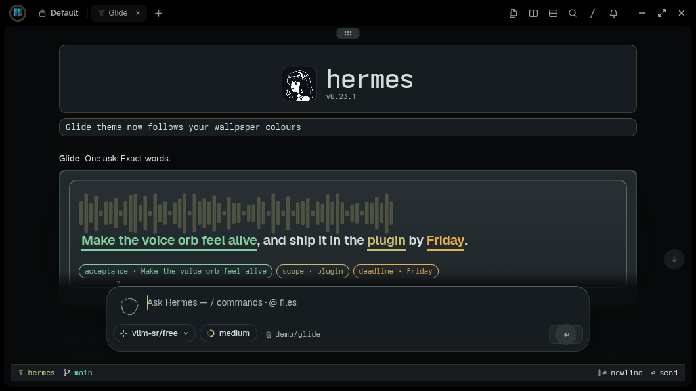 |
| **Convene a council.** `/council` opens a Socratic review where model seats vote on a hard call, one verdict per seat. Without `GLIDE_COUNCIL_URL` the run is a labelled **DEMO**. | 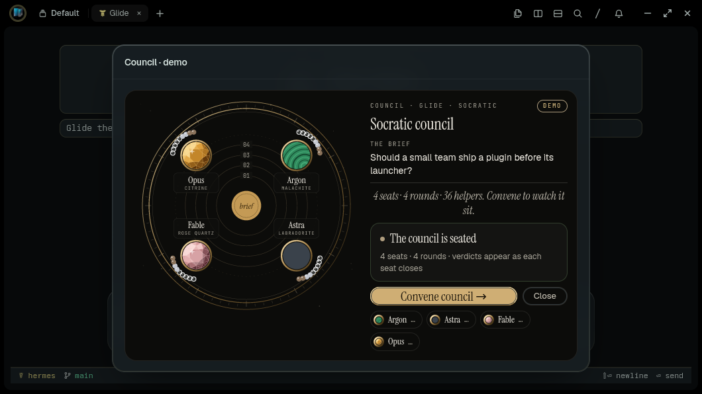 |
| **Watch the lanes.** `/glide lanes` shows each live-voice helper lane's model, billing, state and words. Without a lane broker it says **NOT CONNECTED** instead of drawing one. | 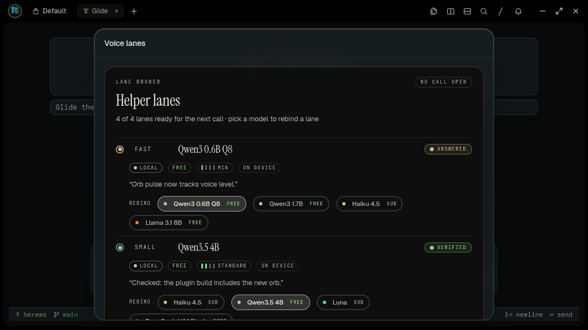 |
| **Hold a deep-work block.** `/glide focus` shows your phase, bedtime and next deep-work window. Start a 50-minute block and non-critical agent asks wait; critical ones still pass. |  |
| **Get one digest.** `/glide focus stop` ends the block and hands back every held ask once. | 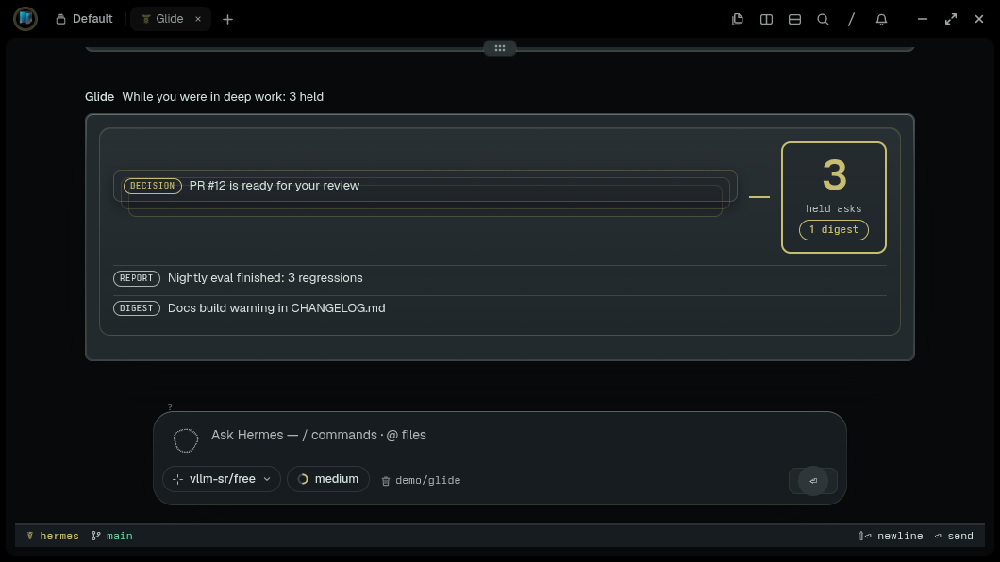 |
| **Know your hours.** `/glide focus hours` draws the two-hour windows you worked in most over 30 days, learned from your own local sessions. |  |
| **Wind down.** `/glide focus wind-down` saves where you left off; tomorrow's first turn starts there. | 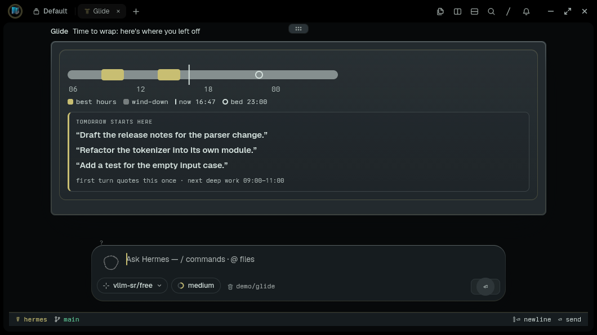 |
| **Ring the composer.** Ask *"add a focus timer that runs around my composer"* and Hermes mounts a focus ring on the composer's border (`glide_ui_mount`). It ticks every second and survives a relaunch. | 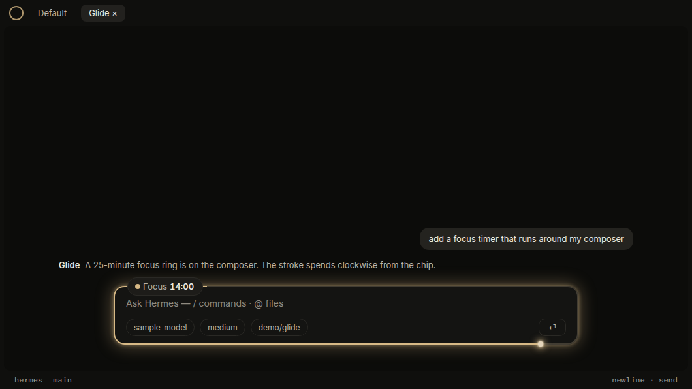 |
| **Graph your commits.** Ask *"add a graph of my commits under the composer"* for a 52-week heatmap of the session repository's git log. It redraws when a commit lands. | 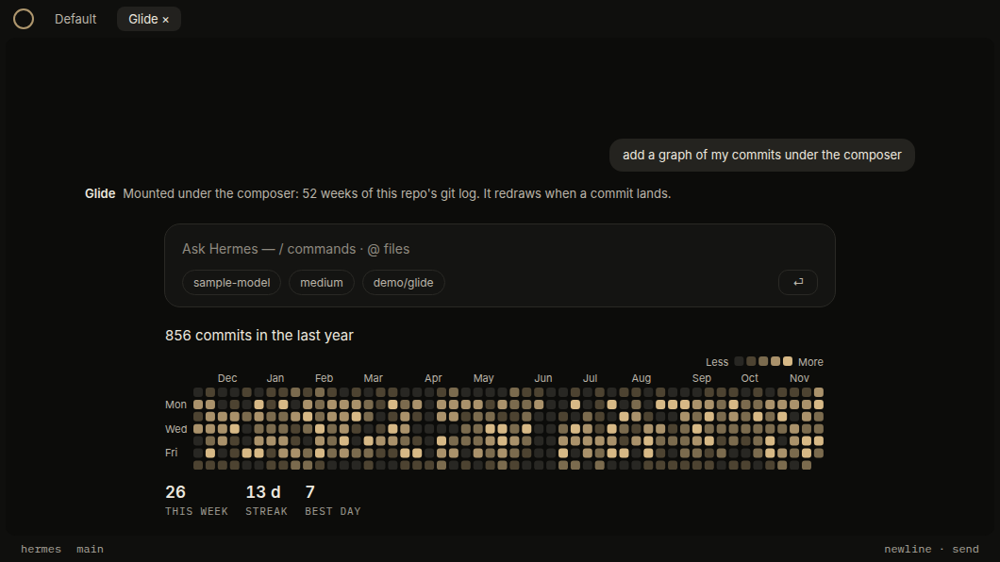 |
| **See the fleet.** `/hosts` lists your hosts' agents, machine gauges and k3s pods from local read-only collectors. Missing sources never become fictional hosts. | 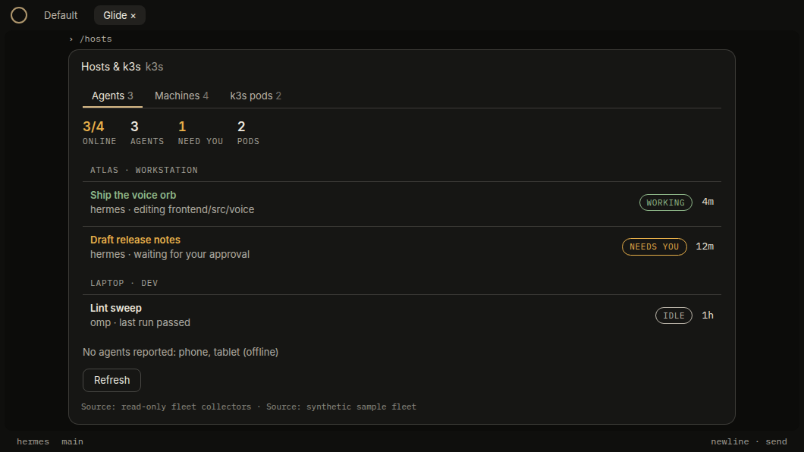 |
| **Wear the wallpaper.** `/glide theme auto` themes Tern from your pywal colours (or `GLIDE_WAL_COLORS`); `dash` picks Dash's black and gold, `default` reverts and `export` writes the palette. | 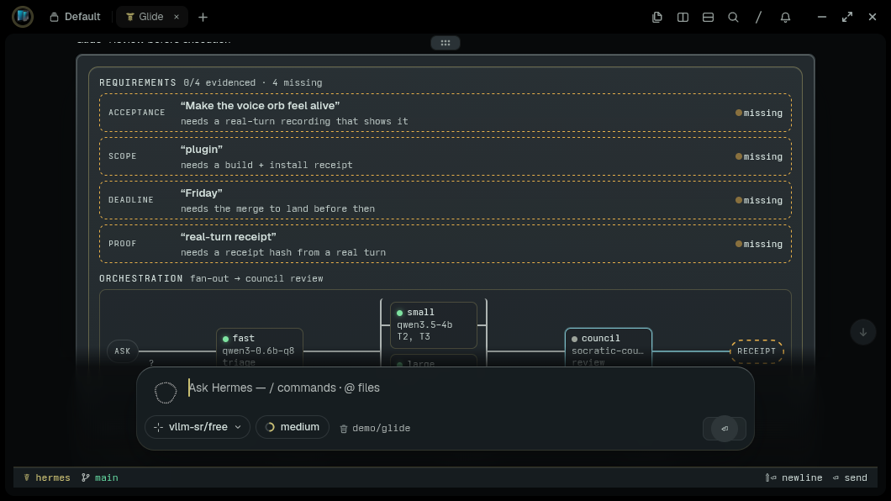 |

Also in the chat: `/portfolio` and `/factory graph` render validated fleet cards, `/intel` shows hill climbs, skills, memory, failures and traces, `/film` opens a fframestudio project, `/glide taste` opens a separately running [Taste Atlas](glide/docs/taste.md) board, `/glide studio` previews an fframestudio project ([requirements](glide/docs/studio.md)), and `/glide glass` is the only surface allowed to glow. Live voice (`/live`, Alt+Shift+V) needs a Hermes gateway with `voice.live` methods and a local lane broker. [Voice and lanes](frontend/docs/voice.md)

Attention features need no wearable. They learn from your local session timestamps and use z0intelligence's circadian schedule and a Flowkit flow estimate when those are installed. [Attention contract](glide/docs/attention.md)

Every card follows one design language: omp's card grammar and Dash's palette, text at 11 px or larger, and no glow outside `/glide glass` and an opt-in focus ring. A token drift test fails on any radius, size or colour that is not a token. [Design language](docs/DESIGN-LANGUAGE.md)

**About these pictures.** The intent, council, lanes, focus, digest, hours, wind-down and theme shots are live Tern takes over synthetic data. The focus ring, heatmap and fleet shots are browser renders of the real widget and card trees over synthetic data, made by [readme-shots.mts](glide/tools/readme-shots.mts); Tern's own renderer draws them slightly differently.

## Corrections memory

`/glide` walks an opt-in onboarding flow. Each write or benchmark waits for its approval button. [Card flow](frontend/src/commands/glide.ts)

1. **Detect** CPU, RAM, GPU, local runtimes and optional z0intelligence health. Detection installs nothing.
2. **Build memory** from up to 100 recent eligible local sessions, excluding the current one. Glide keeps user messages that begin with `Correction:`, `Actually,` or `No,`.
3. **Turn on** recall: up to three matching past corrections are quoted into a turn, so you stop repeating yourself. Current instructions take precedence over quoted history.
4. **Skill router** saves a category-to-skills ranking catalog. It installs metadata, not the referenced skills or a per-turn loader.
5. **Hill climb** runs one CPU benchmark round; the referee reports KEEP, REVERT or INCONCLUSIVE. It edits no code and trains no model.
6. **Offload** sends one sample task to an existing Ollama model and estimates the tokens saved. It is an estimate, not a billing measurement, and no model is downloaded for you.

`/glide recall <words>` shows matching corrections; `/glide off` stops quoting.

| Detect | Memory built | Recall hit |
|---|---|---|
| 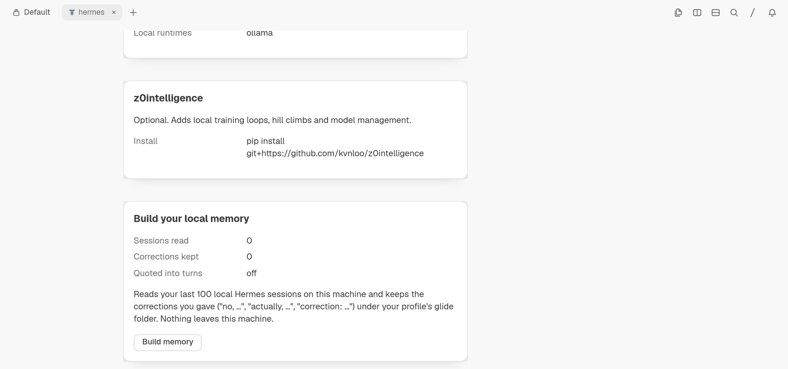 | 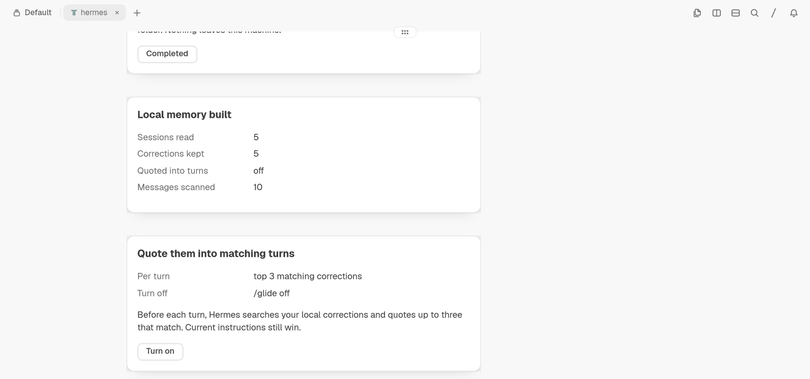 | 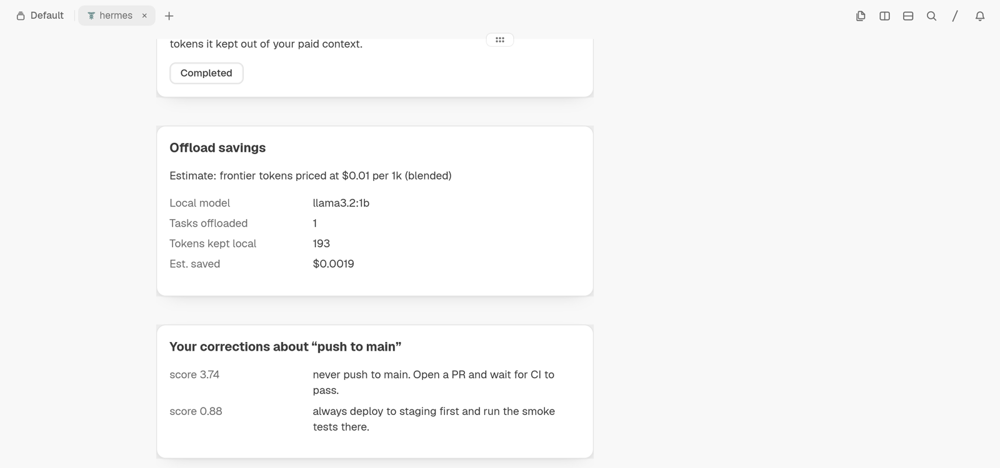 |
| **Skill router** | **Hill climb** | **Offload** |
|  |  | 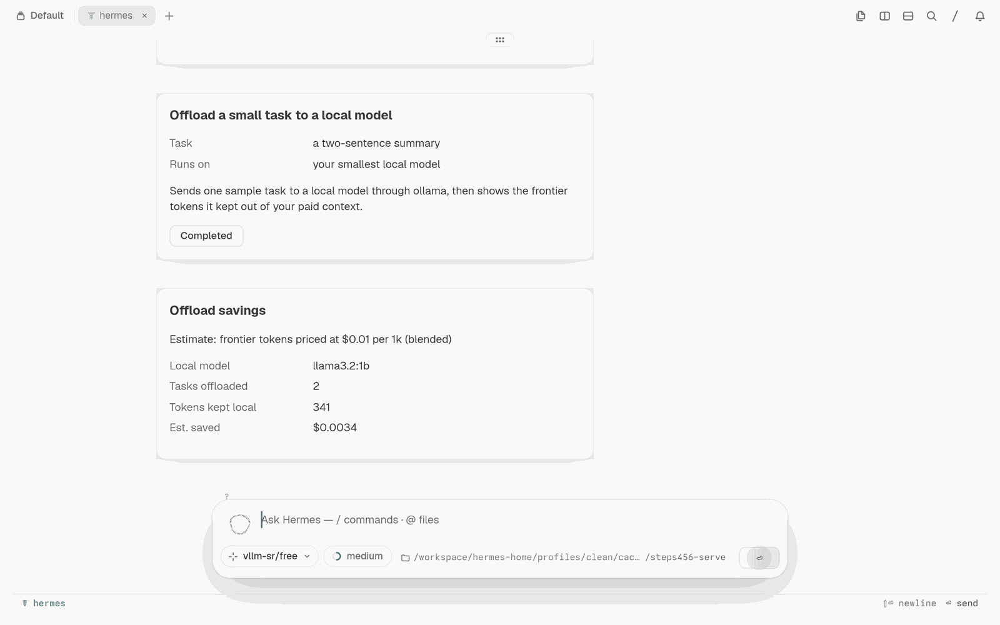 |

Captured in Tern from a fresh `HERMES_HOME` after `hermes plugins install kvnloo/glide`, with six synthetic sessions seeded by [demo/seed.py](glide/demo/seed.py). No personal history appears.

**Privacy.** Extraction and BM25 ranking make no model calls. If an existing z0intelligence corrections reader returns matches, recall prefers those and otherwise falls back to Glide's store. Glide opens the session database read-only and writes derived memory under the profile's `glide/` directory. Once recall is on, quoted excerpts enter Hermes' model context and can reach your configured remote provider, so don't enable it for history you don't want that provider to receive. [Storage and privacy contract](glide/docs/memory.md)

## Check a fresh install yourself

```sh
bash scripts/e2e-fresh-install.sh
```

It installs the committed checkout into a throwaway `HERMES_HOME`, validates the plugin, and exercises memory, focus and Taste with synthetic data through Hermes' command loader. It does not launch Tern, touch your profile, or call a model. [Details](glide/docs/fresh-install.md)

## Code map

- Memory: [backend](glide/memory.py), [source reader](glide/source.py), [atomic storage](glide/storage.py), [hook and command](glide/core.py). The [session-bound gateway methods](glide/gateway.py) need `ctx.register_gateway_method`. Released Hermes does not have it, so those methods stay inactive and the cards run through the `/glide` command.
- Cards: [`/glide` flow](frontend/src/commands/glide.ts), [intent](glide/frontend/intentCards.ts), [council](glide/frontend/councilPopup.ts), [lanes](glide/frontend/lanesPopup.ts), [fleet](frontend/src/commands/fleet.ts) and its [adapter](glide/fleet.py), [theme](glide/frontend/wal.ts) and [glass](glide/frontend/glass.ts).
- Widgets and pages: [agent tools](glide/ui.py), [mounts](frontend/src/glideui/mounts.ts), [widget host](frontend/src/glideui/widgets.tsx).
- [Attention](glide/attention.py), [skill router](glide/skill_router.py), [benchmark](glide/hill_climb.py), [offload](glide/offload.py). Frontend build: [frontend/README.md](frontend/README.md).

## Credits and license

Derived from alt-glitch/hermes-tern (MIT), by [alt-glitch](https://github.com/alt-glitch/hermes-tern). Glide additions are by Kevin Rajan. The frontend began as [can1357's ui-tsp](https://github.com/can1357/hermes-agent/tree/tern-frontend), and some UI patterns come from [T3 Code](https://github.com/pingdotgg/t3code).

MIT. See [LICENSE](LICENSE) and the [Glide license](glide/LICENSE).
